# Project Interview Questions & Answers — Complete Placement Roadmap

> **7 GitHub projects • SDE-1 / Backend / Full-stack / AI-ML interviews • Interview-ready explanations, diagrams, and technical fundamentals**  
> Based on inspection of the listed repository trees, READMEs and representative implementation files on **17 November 2026**. Focus: basic → intermediate, with high-value engineering follow-ups.

**Interview principle:** State **what your code currently does**, then separately discuss **what you would improve**. Never present a proposed design as an already implemented feature. Say "I implemented" only for work you personally did (especially in the team-owned repositories).

## Table of contents

1. [How to prepare from this roadmap](#how-to-prepare-from-this-roadmap)
2. [All seven projects at a glance](#all-seven-projects-at-a-glance)
3. [Project 1 — SnipLink](#project-1--sniplink)
4. [Project 2 — Researcher Aggregation](#project-2--researcher-aggregation)
5. [Project 3 — Real-Time Order Book Visualizer](#project-3--real-time-order-book-visualizer)
6. [Project 4 — Corrective RAG](#project-4--corrective-rag)
7. [Project 5 — AnC Council IIT Kanpur Website](#project-5--anc-council-iit-kanpur-website)
8. [Project 6 — Fama-French Nifty Volatility](#project-6--fama-french-nifty-volatility)
9. [Project 7 — Reinforcement Learning Capstone](#project-7--reinforcement-learning-capstone)
10. [Tech-stack interview question bank](#tech-stack-interview-question-bank)
11. [Cross-project engineering questions](#cross-project-engineering-questions)
12. [Final revision checklist](#final-revision-checklist)
13. [Evidence and caveats](#evidence-and-caveats)

## How to prepare from this roadmap

- **Round 1 (60 seconds):** Present the problem, users, stack, your role, and one important design decision.
- **Round 2 (whiteboard):** Draw the architecture from memory and explain one end-to-end request.
- **Round 3 (10–15 minutes):** Answer the highest-priority questions first; use concrete files/functions as evidence.
- **Round 4 (follow-up):** Explain the failure mode or limitation and propose a precise fix.
- **Round 5 (tech stack):** Revise JavaScript/React/Node/Python/SQL/Redis/WebSockets/ML fundamentals that the project triggers.

**Labels used:** `IMPLEMENTED` = verified in representative source files; `README-CLAIM` = project README reports this but implementation not fully independently validated; `PROPOSED` = improvement/interview design, **not** a claim about current code. 🔥 denotes a particularly likely follow-up.

## All seven projects at a glance

| Project | Source repository | Defensible primary areas | Most likely follow-ups |
|---|---|---|---|
| SnipLink | [piyush0028/SnipLink](https://github.com/piyush0028/SnipLink) | Express, TypeScript, Prisma/PostgreSQL, Redis, RabbitMQ, Next.js | cache miss, event reliability, JWT, rate limiting |
| Researcher Aggregation | [itssunny1801/Researcher-Aggregation](https://github.com/itssunny1801/Researcher-Aggregation) | Next.js, React, FastAPI, ORCID OAuth2, JWT, mock directory | OAuth sequence, search evolution, auth security |
| Real-Time Order Book | [piyush0028/order-book-visualizer](https://github.com/piyush0028/order-book-visualizer) | Next.js, React, TypeScript, Binance WebSockets | depth updates, reconnection, consistency, performance |
| Corrective RAG | [piyush0028/crag-project](https://github.com/piyush0028/crag-project) | React/Vite, FastAPI, ChromaDB, Gemini | embeddings, retrieval quality, query rewriting, hallucination |
| AnC Council Website | [AnC-Council-IIT-Kanpur/Website](https://github.com/AnC-Council-IIT-Kanpur/Website) | Next.js App Router, React, TypeScript, Tailwind | components, SSR/CSR, hydration, performance |
| Fama-French Nifty Volatility | [piyush0028/Fama-French-Nifty-Volatility](https://github.com/piyush0028/Fama-French-Nifty-Volatility) | Python, factor models, OLS, GARCH/EGARCH | factors, regression, risk, look-ahead bias |
| Reinforcement Learning Capstone | [piyush0028/Reinforcement-Learning-Capstone](https://github.com/piyush0028/Reinforcement-Learning-Capstone) | PyTorch, Dueling Double DQN, replay, target network | Bellman targets, exploration, state design, evaluation |

---

# Project 1 — SnipLink

**Repository:** https://github.com/piyush0028/SnipLink  
**Stack verified:** Next.js frontend; Express + TypeScript API; PostgreSQL through Prisma; Redis cache and Lua-script rate limiting; RabbitMQ click-event queue and worker; bcrypt/JWT; Docker Compose.

### 45–60-second introduction

> "I built a URL shortener with a Next.js dashboard and an Express/TypeScript backend. PostgreSQL is the source of truth; short codes come from a database sequence encoded in Base62. Redirects first check Redis and fall back to PostgreSQL, while click analytics are sent to RabbitMQ for processing by a separate worker. I also implemented JWT authentication with refresh-token rotation, rate limiting, and URL analytics. The interesting decisions were keeping redirects fast without losing data integrity and handling cache/queue failures."

### Architecture — current implementation

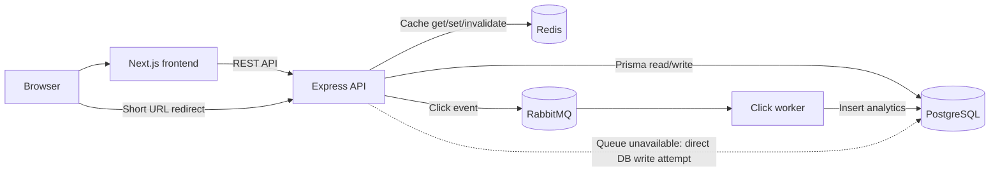

### End-to-end short-link redirect

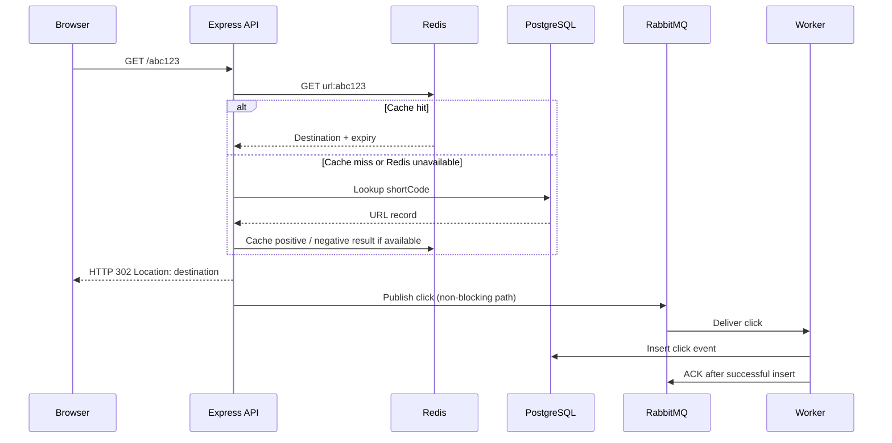

**Precision:** The redirect controller starts click logging without awaiting it. The producer can attempt a direct DB write if the RabbitMQ channel is absent; this is **not a strict exactly-once or guaranteed-delivery system**.

### Important implementation references

- [URL service: create/update/resolve/cache](https://github.com/piyush0028/SnipLink/blob/main/backend/src/modules/url/url.service.ts)
- [Controller: redirect + click logging](https://github.com/piyush0028/SnipLink/blob/main/backend/src/modules/url/url.controller.ts)
- [Prisma model / unique constraints / indexes](https://github.com/piyush0028/SnipLink/blob/main/backend/prisma/schema.prisma)
- [Redis caching & TTL](https://github.com/piyush0028/SnipLink/blob/main/backend/src/cache/url-cache.util.ts)
- [Lua sliding-window rate limiter](https://github.com/piyush0028/SnipLink/blob/main/backend/src/middlewares/rateLimit.middleware.ts)
- [RabbitMQ click publisher](https://github.com/piyush0028/SnipLink/blob/main/backend/src/queue/click.producer.ts) · [worker](https://github.com/piyush0028/SnipLink/blob/main/backend/src/workers/click.worker.ts)
- [Authentication service / refresh rotation](https://github.com/piyush0028/SnipLink/blob/main/backend/src/modules/auth/auth.service.ts)

### Most anticipated project-defense questions

**Q1. 🔥 Why PostgreSQL AND Redis?**  
**Answer:** PostgreSQL stores durable authoritative URLs, users and events. Redis is an optional speed layer for repeated redirects; if it fails, the redirect service can still read PostgreSQL. This is the cache-aside pattern.

**Q2. 🔥 Walk me through a cache miss.**  
**Answer:** `resolveRedirect` first calls Redis; on miss it reads `shortCode` using Prisma, validates activity/expiry, then caches the mapping for one hour before returning a 302 redirect.

**Q3. What is negative caching, and why use it?**  
**Answer:** Invalid short codes are cached with a `NOT_FOUND` marker for **60 seconds**, avoiding repeated database queries for the same nonexistent key. Risk: a newly created alias may need invalidation, which creation does.

**Q4. 🔥 What if Redis goes down?**  
**Answer:** Cache helpers catch errors/skip reads and writes, so URL resolution falls back to PostgreSQL. Redis-backed rate limiting **fails open** in the current middleware, allowing requests through; this is an availability-versus-abuse trade-off.

**Q5. How do you create unique short codes?**  
**Answer:** The repository obtains a PostgreSQL sequence value and Base62-encodes it. The schema also enforces a unique `shortCode`. A user-supplied custom alias must also satisfy the unique constraint; prechecking alone cannot prevent races.

**Q6. Why Base62 instead of random UUID strings?**  
**Answer:** Base62 turns a numeric ID into a compact URL-friendly code using digits and letters. Its trade-off is predictability: sequence-based codes are enumerable, so they are **not access-control secrets**.

**Q7. 🔥 Why RabbitMQ for click tracking?**  
**Answer:** Writing every click synchronously would add database latency to redirection. A separate consumer decouples click ingestion from the HTTP response and enables independent worker scaling.

**Q8. Is the click pipeline exactly-once?**  
**Answer:** No. The worker manually ACKs after insert, so delivery can repeat after a crash between insert and ACK. Events also risk loss during producer or failure paths; reliable outbox/confirm publishing plus event IDs and idempotent inserts would improve correctness.

**Q9. What happens when a worker crashes?**  
**Answer:** A message not ACKed can be redelivered by RabbitMQ when the channel/connection closes. Current `nack(msg, false, false)` on processing exceptions **does not requeue**; configure dead-letter handling and retries as a proposed improvement.

**Q10. Is there really batch insert in the current click worker?**  
**Answer:** The README describes batch processing, but the inspected worker calls `createClickEvent` **once per message**, with `prefetch(1)`. Batching is a future optimization, not a feature to claim currently.

**Q11. 🔥 How does update/delete avoid stale cached URLs?**  
**Answer:** The service updates/soft-deletes the PostgreSQL row and then invalidates the `url:<code>` cache entry. A small race remains between database commit and cache invalidation; under stricter consistency needs we could use versioned values or coordinated invalidation.

**Q12. How does rate limiting work?**  
**Answer:** A Redis sorted set stores request timestamps. A Lua script atomically removes old timestamps, checks the count, inserts the new member and sets expiry. Current configured limits include **20 URL creations/minute/user**, **100 redirects/minute/IP**, **5 logins/minute/IP**, and **5 registrations/hour/IP**.

**Q13. Why Lua and not separate Redis commands?**  
**Answer:** Without atomic execution, simultaneous requests could each observe a count below the limit and all pass. Lua executes the check-and-add as one atomic Redis operation.

**Q14. How do JWT login and refresh work?**  
**Answer:** Credentials are verified against bcrypt password hashes; access and refresh JWTs are issued. Refresh tokens are hashed in the database and rotated; reuse of revoked tokens triggers revocation of all that user's sessions. Discuss concurrency around simultaneous refreshes.

**Q15. What is an index and which indexes matter here?**  
**Answer:** Unique indexes on `shortCode` and email accelerate lookups and enforce uniqueness. `Url.userId` supports dashboard lists; `ClickEvent(urlId, clickedAt)` supports per-link timeline queries. Each additional index costs write space/time.

**Q16. Why a 302 redirect rather than 301?**  
**Answer:** 302 indicates a temporary redirect and reduces the risk of clients permanently caching the destination. It is useful when the target can be edited later.

**Q17. What happens under 10,000 requests for the same short code?**  
**Answer:** Once cached, most requests read Redis rather than PostgreSQL. On a cold cache, concurrent misses can still cause a cache stampede; a single-flight lock/request coalescing would improve this.

**Q18. How would you scale this to much higher traffic?**  
**Answer:** Horizontally scale stateless API instances behind a load balancer; monitor Redis, PostgreSQL connections, queue backlog and worker throughput. Then add hot-key caching/replicas and analytics partitioning only where measurements justify them.

**Q19. What is the most important limitation in your implementation?**  
**Answer:** The click pipeline has no documented end-to-end delivery guarantee, producer confirms or idempotent event IDs. Improving durable event publication and dead-letter handling is more valuable than claiming arbitrary throughput.

**Q20. How would you test the system?**  
**Answer:** Unit test Base62 and auth rules; integration test create→redirect→update→delete, rate limits and cache failures; simulate duplicate click messages and broker outage; load-test p95/p99 redirect latency separately from analytics completeness.

### Traps to avoid

- `IMPLEMENTED`: positive cache TTL **3600 s**, negative cache TTL **60 s**; Redis fail-open for rate limiting. Don't quote older limits from memory.
- `IMPLEMENTED`: sequential per-message worker insert; **not** a batch insert.
- `PROPOSED`: publisher confirmations, outbox, retry/dead-letter queue, click-event deduplication, cache-stampede protection.
- Do **not** promise clicks are never dropped or that redirects are always sub-millisecond; no benchmark evidence was verified.

---

# Project 2 — Researcher Aggregation

**Repository:** https://github.com/itssunny1801/Researcher-Aggregation  
**Stack verified:** Next.js App Router, React, TypeScript, Tailwind-based UI, Python FastAPI, `httpx`, ORCID OAuth2, JWT. Directory search is currently **client-side over mock data**; backend profile saving uses a local JSON file.

### 45–60-second introduction

> "I worked on a researcher discovery and profile interface with a Next.js frontend and a FastAPI authentication service. The current frontend supports searchable researcher cards and profile pages using local sample data. The authentication flow uses ORCID OAuth2: the user is redirected to ORCID, the backend exchanges the authorization code, and the application issues a JWT. A natural production extension would replace the mock directory and file-based profiles with a persistent searchable database."

**Important accuracy check:** Earlier resume-style descriptions may mention **PostgreSQL, pgvector, semantic search and external aggregation**. These are **not implemented in the inspected repository tree/code**. Present them as proposed architecture unless you have a different private branch/service to demonstrate.

### Architecture — current implementation

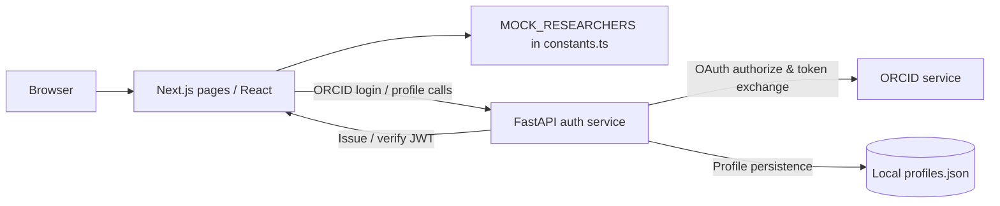

### End-to-end ORCID login

```mermaid
sequenceDiagram
    participant U as Browser
    participant N as Next.js UI
    participant A as FastAPI
    participant O as ORCID
    U->>N: Click Login with ORCID
    N->>A: GET /auth/orcid/login
    A-->>U: Redirect to ORCID authorization
    U->>O: Login / consent
    O-->>A: Callback with authorization code
    A->>O: Exchange code for token; optional userinfo
    O-->>A: ORCID identity
    A-->>U: Redirect to /auth/callback?token=JWT
    U->>N: Callback stores app token
```

**Security note:** Current code sends the application JWT in a URL query parameter, stores it in browser localStorage and later sends it as a Bearer authorization header. The backend can also read a cookie, but the active callback does **not** set one. Treat cookie-based auth in older documentation as a mismatch, not as the current login transport.

### Important implementation references

- [FastAPI app and enabled routes](https://github.com/itssunny1801/Researcher-Aggregation/blob/main/backend/app/main.py)
- [ORCID login/callback, JWT, profile persistence](https://github.com/itssunny1801/Researcher-Aggregation/blob/main/backend/app/routers/auth.py)
- [Client-side search](https://github.com/itssunny1801/Researcher-Aggregation/blob/main/src/app/search/page.tsx)
- [Sample researchers and constants](https://github.com/itssunny1801/Researcher-Aggregation/blob/main/src/lib/constants.ts)
- [Dynamic profile page](https://github.com/itssunny1801/Researcher-Aggregation/blob/main/src/app/researcher/%5Bid%5D/page.tsx)

### Most anticipated project-defense questions

**Q1. 🔥 What problem does the project solve?**  
**Answer:** It provides a UI to discover researchers by name, institution, department, field and country, view their profiles, and authenticate through ORCID.

**Q2. What is actually live in the search implementation?**  
**Answer:** React filters the `MOCK_RESEARCHERS` array with case-insensitive substring comparisons. This is a functional prototype, **not yet a database-backed semantic search service**.

**Q3. 🔥 How does OAuth2 authorization-code flow work?**  
**Answer:** Redirect user to the identity provider → receive a temporary code → backend exchanges it with client credentials → retrieve identity → create an application session/token. The client secret stays on the backend.

**Q4. What is ORCID?**  
**Answer:** ORCID provides persistent researcher identifiers. Using it for login avoids building a separate identity-verification flow and ties a session to a research identity.

**Q5. What is the difference between OAuth2 and JWT?**  
**Answer:** OAuth2 is an authorization framework/flow; a JWT is a token format carrying signed claims. This project uses OAuth2 to obtain identity and a locally created JWT for its application session.

**Q6. 🔥 Is your authentication storage ideal?**  
**Answer:** No. Passing JWTs in callback URLs risks leakage to browser history/logs, while localStorage is exposed to XSS. A safer design uses a backend-managed session with Secure, HttpOnly, SameSite cookies, state/nonce validation and CSRF protection as applicable.

**Q7. What is CORS and why is it needed?**  
**Answer:** Browsers enforce same-origin rules for cross-origin reads. FastAPI CORS middleware explicitly permits the configured frontend origin and credentials so the UI can call the auth backend.

**Q8. How would you make researcher search truly semantic?**  
**Answer:** In a proposed architecture, ingest profiles/publications into PostgreSQL, build embeddings, store vectors with pgvector, retrieve candidates by similarity and apply metadata filtering/reranking. It's **not shown in the present repo**.

**Q9. Why use Next.js rather than plain React?**  
**Answer:** File-based routing, server-rendered pages, metadata generation and React integration make it convenient for a multi-page discovery platform.

**Q10. How are dynamic researcher pages implemented?**  
**Answer:** The route `researcher/[id]` receives an ID, finds a matching entry in the mock array, builds metadata and renders a profile or a not-found state.

**Q11. What are the scaling limitations of client-side filtering?**  
**Answer:** All records must be shipped to the browser and each search scans the array. For large data, move search to an indexed API with pagination, caching and server-side filtering.

**Q12. Is `profiles.json` a production database?**  
**Answer:** No. It is local file persistence suitable for a prototype but prone to concurrent-write problems, deployment resets, and limited queryability; use transactional storage for production.

**Q13. How would you handle duplicate researcher profiles?**  
**Answer:** Treat verified ORCID iD as a strong identity key, normalize metadata and merge duplicate external records carefully; avoid merging solely by name.

**Q14. What security checks should an OAuth callback add?**  
**Answer:** Validate OAuth `state`, handle provider errors, configure exact redirect URIs, avoid leaking authorization results, use HTTPS, validate token audience/issuer where appropriate and protect app-session storage.

**Q15. What would you improve first?**  
**Answer:** Resolve token/cookie inconsistency, add robust session security, then build a real database-backed researcher search API with tests, pagination and logging.

**Q16. What are the clean boundaries between frontend and backend?**  
**Answer:** Next.js handles views, navigation and user interaction; FastAPI owns sensitive ORCID secret exchange and token validation. Search data should eventually be owned by a backend service rather than hard-coded in the browser.

### Traps to avoid

- **Do not claim a working pgvector semantic-search backend from this repository.** The checked search page filters `MOCK_RESEARCHERS`.
- JWT-in-query/localStorage versus cookie documentation is a code inconsistency worth acknowledging.
- Clearly explain your personal contributions to this shared-owner repository.

---
# Project 3 — Real-Time Order Book Visualizer

**Repository:** https://github.com/piyush0028/order-book-visualizer  
**Stack verified:** Next.js App Router, React, TypeScript, direct browser WebSocket connection to Binance, React hooks, Tailwind. `package.json` contains Zustand and TanStack Query dependencies, but the inspected streaming path uses `useState`, `useRef`, `useEffect`, `useCallback`, **not a Zustand store**. **Version note:** README says Next.js 14; current `package.json` specifies **Next.js 16.0.1**, so trust the manifest for checked code.

### 45–60-second introduction

> "I developed a real-time BTC/USDT order book dashboard using Next.js, TypeScript and the Binance WebSocket API. A custom React hook connects to aggregated trades and depth updates, maintains bid/ask levels, computes cumulative quantities and spread, and updates the UI. It also handles disconnects and reconnection attempts. The most interesting challenges are managing a high-frequency stream efficiently and maintaining correct order-book state when data arrives incrementally."

### Architecture — current implementation

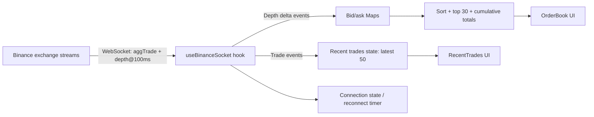

### Event-processing sequence

```mermaid
sequenceDiagram
    participant U as Browser
    participant H as React WebSocket hook
    participant B as Binance
    participant R as React components
    H->>B: Open wss://stream.binance.com:9443/ws
    B-->>H: WebSocket open
    H->>B: SUBSCRIBE btcusdt@aggTrade and btcusdt@depth@100ms
    loop Incoming events
        B-->>H: aggTrade or depthUpdate
        H->>H: Parse / validate / update state
        H-->>R: Trigger React render
    end
    B--xH: Connection closed
    H->>H: Mark disconnected; schedule reconnect after 3s
```

### Important implementation references

- [WebSocket lifecycle, incremental updates, reconnect](https://github.com/piyush0028/order-book-visualizer/blob/main/src/hooks/useBinanceSocket.ts)
- [OrderBook display and spread](https://github.com/piyush0028/order-book-visualizer/blob/main/src/components/OrderBook/OrderBook.tsx)
- [Trades and animations](https://github.com/piyush0028/order-book-visualizer/blob/main/src/components/RecentTrades/RecentTrades.tsx)
- [Types](https://github.com/piyush0028/order-book-visualizer/blob/main/src/types/index.ts)

### Most anticipated project-defense questions

**Q1. 🔥 What is an order book?**  
**Answer:** It shows resting buy orders (bids) and sell orders (asks) by price level and quantity. Highest bid and lowest ask determine the top of book.

**Q2. What is the bid-ask spread?**  
**Answer:** `bestAsk - bestBid`. The UI also displays a percentage relative to the best bid. A tighter spread often indicates greater liquidity, all else equal.

**Q3. 🔥 Why WebSockets instead of polling HTTP?**  
**Answer:** A persistent bidirectional connection delivers frequent market updates without a separate HTTP request for every interval. It generally reduces polling overhead and latency for continuous feeds.

**Q4. Which Binance streams do you subscribe to?**  
**Answer:** `btcusdt@aggTrade` for aggregated trade events and `btcusdt@depth@100ms` for depth updates.

**Q5. 🔥 How are depth updates applied?**  
**Answer:** The hook copies the current bid/ask price→quantity Maps, updates levels from each message, removes levels with zero quantity, sorts bids descending/asks ascending, keeps the top 30, then calculates cumulative totals.

**Q6. What is cumulative depth?**  
**Answer:** A running sum of level quantities. At bid level `i`, cumulative quantity equals the sum of bid sizes from the best bid through `i`. It helps visualize available depth.

**Q7. How do you handle reconnecting?**  
**Answer:** The socket's `onclose` marks it disconnected and schedules a new `connect()` after **three seconds**. A production version should add exponential backoff, jitter, subscription recovery and explicit resynchronization; the current `onclose` also schedules reconnect even after a deliberate `disconnect()` and should check intentional shutdown.

**Q8. 🔥 What is the biggest correctness problem with this order book?**  
**Answer:** It applies WebSocket deltas without first fetching and synchronizing an authoritative REST snapshot using Binance update IDs. After connection gaps or missed updates, displayed book levels may be incorrect.

**Q9. Why might storing only the top 30 levels lose information?**  
**Answer:** Each update reconstructs state from the already truncated top 30. If a removed deeper level later becomes relevant, the local Map may no longer contain it. Preserve a complete synchronized book before slicing for display.

**Q10. What happens if the stream sends hundreds of updates per second?**  
**Answer:** Immediate React state updates can cause repeated renders and sorting. Batch updates, maintain a mutable data structure outside rendering, throttle UI refreshes (e.g., animation frames), and profile actual latency.

**Q11. Why use `useRef` for the WebSocket object?**  
**Answer:** The socket and reconnect timer are mutable objects that should survive renders but should not trigger a rerender just because their references change.

**Q12. Why `useCallback` for connect/update functions?**  
**Answer:** It provides stable function identities between renders when dependencies remain unchanged, useful for effects and memoized callbacks. It is not automatically a performance improvement in every component.

**Q13. What is the trade-off between Map and array here?**  
**Answer:** Map makes price-level replacement/deletion convenient; arrays are better suited for sorting and rendering. The implementation converts Map entries to sorted arrays on updates.

**Q14. What does `isBuyerMaker` indicate?**  
**Answer:** It indicates whether the buyer was the maker in Binance aggregated-trade data. If true, the sell side was typically the aggressor; the UI uses the flag to color the trade direction.

**Q15. How do you avoid memory growth in the trade feed?**  
**Answer:** The hook keeps only the latest **50** trades. A bounded list prevents growth as new events arrive.

**Q16. Is Zustand used to store live book state?**  
**Answer:** Although Zustand is listed as a dependency, the checked data flow uses local React state in the custom hook. Don't claim a implemented centralized Zustand store without pointing to one.

**Q17. How would you test correctness?**  
**Answer:** Feed deterministic snapshots and deltas, assert zero-quantity deletions, bid/ask order, cumulative totals and trade retention. Simulate duplicate/out-of-order events, disconnects and snapshot resync.

**Q18. What would you improve first?**  
**Answer:** Implement the official snapshot-plus-diff synchronization algorithm with sequence validation. After correctness, optimize rendering frequency and reconnect backoff.

### Traps to avoid

- WebSocket updates **alone do not guarantee a consistent order book**; a REST snapshot and sequence-ID logic are missing from the inspected hook. Also guard `onclose` to avoid reconnecting after intentional unmount.
- The README version and dependency manifest differ; cite actual installed manifest when asked.
- No verified backend trade processing or historical order storage. The connection is **directly from browser to Binance**.

---

# Project 4 — Corrective RAG

**Repository:** https://github.com/piyush0028/crag-project  
**Stack verified:** Python FastAPI, ChromaDB persistent collection, Google GenAI SDK / Gemini embedding and generation models, React + Vite frontend, axios. The current `/ask` endpoint returns **logs after the request finishes**, not server-sent live token streaming.

### 45–60-second introduction

> "I built a corrective retrieval-augmented generation application. A React frontend sends a question to FastAPI. The backend embeds the question, retrieves relevant documents from persistent ChromaDB, asks an LLM to evaluate whether the context is sufficient and, if not, rewrites the question and retrieves again. Finally it generates an answer constrained by retrieved context and returns a trace of the pipeline steps. The key design decision is to add a retrieval-quality check rather than always trusting the first search result."

### Architecture — current implementation

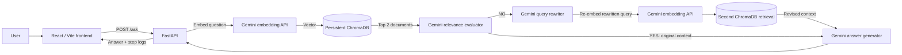

### Request sequence — corrective retrieval

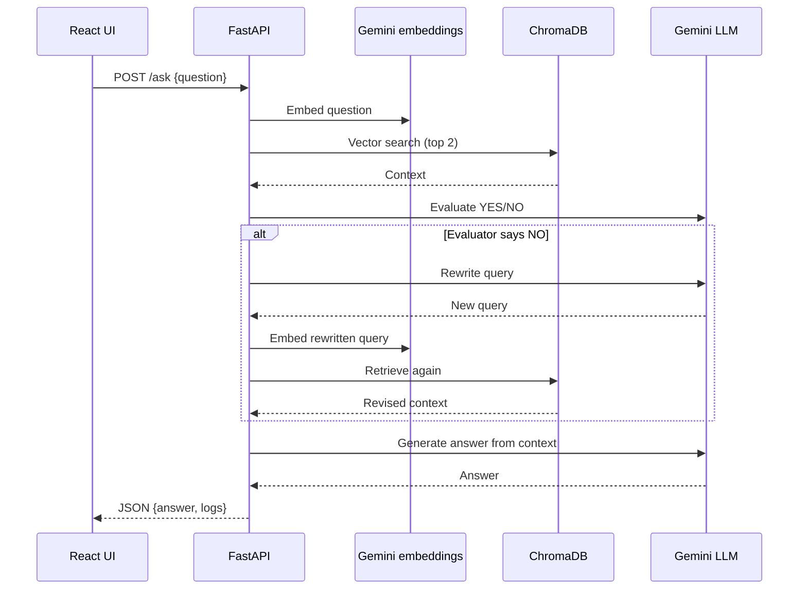

### Important implementation references

- [Actual FastAPI retrieval, evaluation, rewrite, generation](https://github.com/piyush0028/crag-project/blob/main/main.py)
- [Standalone corrective pipeline](https://github.com/piyush0028/crag-project/blob/main/crag_pipeline.py)
- [React client and axios call](https://github.com/piyush0028/crag-project/blob/main/frontend/src/App.jsx)
- [Embedding/retrieval test examples](https://github.com/piyush0028/crag-project/blob/main/test_embedding.py) · [evaluator checks](https://github.com/piyush0028/crag-project/blob/main/test_evaluator.py)

### Most anticipated project-defense questions

**Q1. 🔥 What is RAG?**  
**Answer:** Retrieval-augmented generation retrieves task-relevant external information and supplies it to the LLM during answer generation, reducing dependence on the model's stored knowledge.

**Q2. What makes corrective RAG different from basic RAG?**  
**Answer:** Basic RAG usually retrieves then generates. This system checks relevance first and, if insufficient, rewrites the query and retrieves a second time.

**Q3. 🔥 Explain your exact pipeline.**  
**Answer:** Query → Gemini embedding → ChromaDB top-2 vector search → Gemini YES/NO evaluation → optional query rewrite and second retrieval → Gemini answer generation → JSON response with step logs.

**Q4. What is an embedding?**  
**Answer:** A numerical vector representing semantic information. Similar meanings tend to have similar vectors under a useful embedding model, enabling approximate semantic retrieval.

**Q5. Why ChromaDB?**  
**Answer:** It stores document embeddings and metadata and supports similarity search. The current implementation opens a persistent collection named `internship_knowledge`.

**Q6. 🔥 How does relevance evaluation work currently?**  
**Answer:** It asks the Gemini generation model to answer `YES` or `NO` about whether the retrieved context contains the answer. The code checks whether the returned string includes `NO`, which is a brittle parser.

**Q7. Why rewrite the query?**  
**Answer:** User wording may not match the indexed documents. Expanding synonyms or replacing vague terms can move the query embedding closer to relevant stored passages.

**Q8. What if the rewritten query still retrieves bad context?**  
**Answer:** The current implementation proceeds to generation after **one** correction attempt; it does not reevaluate repeatedly or abstain. A production version would use bounded retries, confidence thresholds and no-answer behavior.

**Q9. 🔥 How do you prevent hallucinations?**  
**Answer:** The generation prompt says to answer only from supplied context, but prompts alone cannot guarantee grounding. Add citations, explicit insufficiency handling and retrieval/answer evaluation tests.

**Q10. Why can embeddings work better than keyword search?**  
**Answer:** Embeddings capture semantic similarity across wording differences. Keyword search remains useful for precise names, codes and rare terms; hybrid retrieval can combine both.

**Q11. What retrieval metric is used?**  
**Answer:** The inspected code calls `collection.query(query_embeddings=[vector], n_results=2)`. It does not explicitly configure or report a distance metric at query time; inspect collection settings before claiming cosine versus L2.

**Q12. Is this an agent?**  
**Answer:** It is a conditional RAG workflow with an evaluation-and-rewrite branch. Calling it an autonomous multi-tool agent would overstate the code.

**Q13. Are the 'reasoning logs' streamed live?**  
**Answer:** No. The backend builds an array of step-status strings and returns them in a **single JSON response** after generation completes.

**Q14. 🔥 Why can the FastAPI endpoint have performance issues?**  
**Answer:** It declares `async def` but calls synchronous SDK/database functions in the request path, potentially blocking the event loop. Use async-capable clients or threadpool execution and configure timeouts.

**Q15. What are the main security risks?**  
**Answer:** Prompt injection through documents, API-key exposure, broad CORS configuration, and user-supplied costly queries. Treat retrieved text as untrusted; isolate secrets and apply validation, quotas and monitoring.

**Q16. How would you measure if CRAG improves over baseline RAG?**  
**Answer:** Use a fixed labeled query set; compare recall@k, context relevance, answer correctness/faithfulness, abstention quality, p95 latency and cost. Test the baseline and corrective flow on the same queries.

**Q17. How would you handle very large documents?**  
**Answer:** Chunk by meaningful boundaries with overlap where appropriate, embed and index chunks, retrieve candidates, rerank them and avoid exceeding context/token budgets.

**Q18. What is your biggest next improvement?**  
**Answer:** Add robust structured relevance scoring, insufficient-evidence refusal, source citations and automated evaluation; then optimize asynchronous execution and caching.

### Traps to avoid

- `IMPLEMENTED`: one optional rewrite/retrieval pass, then answer generation; **not** an unlimited self-correcting loop.
- `IMPLEMENTED`: top **2** passages requested per retrieval; **not** verified reranking or hybrid retrieval.
- `IMPLEMENTED`: logs returned after processing, **not true real-time streaming**.
- `PROPOSED`: reliability thresholds, structured evaluator output, citations, hybrid search, background indexing.

---

# Project 5 — AnC Council IIT Kanpur Website

**Repository:** https://github.com/AnC-Council-IIT-Kanpur/Website  
**Stack verified:** Next.js App Router, React, TypeScript, Tailwind, Framer Motion, UI component libraries and static content/assets. The inspected repository contains route pages, UI components and static data, but **no `app/api` backend route or project-owned database implementation** in the retrieved tree.

### 45–60-second introduction

> "I contributed to the Academic and Cultural Council website at IIT Kanpur, built using Next.js, React, TypeScript and Tailwind. It presents council information, wing-specific pages, events, resources, and interactive UI. The codebase uses reusable components, App Router routes, animations and responsive styling. The main engineering considerations are maintainable component structure, loading performance, accessibility, SEO and correctly separating server-rendered pages from browser-only functionality."

**Team-project honesty:** Replace the generic `contributed` phrase with **your exact components, pages, code reviews or fixes**. A repository proves features exist, not which individual wrote them.

### Architecture — current implementation

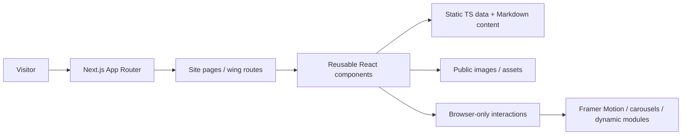

### Typical page-rendering flow

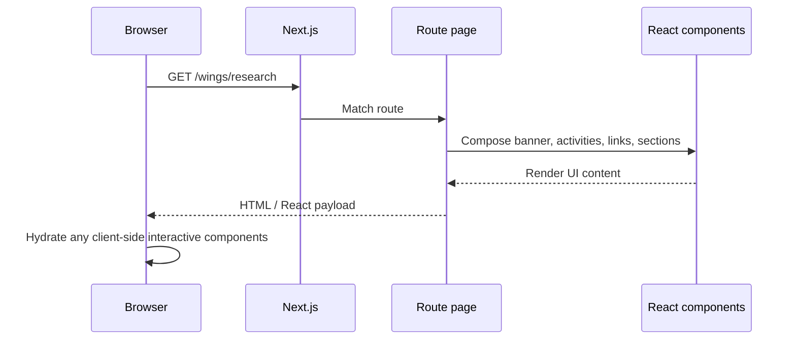

### Important implementation references

- [Homepage composition](https://github.com/AnC-Council-IIT-Kanpur/Website/blob/main/app/%28site%29/page.tsx)
- [Research wing route](https://github.com/AnC-Council-IIT-Kanpur/Website/blob/main/app/%28site%29/wings/research/page.tsx)
- [Shared header](https://github.com/AnC-Council-IIT-Kanpur/Website/blob/main/components/Header/index.tsx)
- [Contact form UI](https://github.com/AnC-Council-IIT-Kanpur/Website/blob/main/components/Contact/index.tsx)
- [Project dependency manifest](https://github.com/AnC-Council-IIT-Kanpur/Website/blob/main/package.json)

### Most anticipated project-defense questions

**Q1. 🔥 What was your contribution to this team project?**  
**Answer:** State your exact pages/components/features, decisions, bugs fixed, collaborators, testing and outcome. Do **not** claim you built the whole council website unless that is accurate.

**Q2. Why Next.js instead of React alone?**  
**Answer:** Next.js adds routing, server rendering, metadata, code splitting and production optimizations around React. It's useful for a multi-page public site.

**Q3. 🔥 Server Components vs Client Components?**  
**Answer:** Server Components render on the server and can avoid shipping unnecessary component JS; Client Components (`"use client"`) run interactive logic/hooks in the browser. Use Client Components when state, effects or browser APIs are needed.

**Q4. How do you structure reusable components?**  
**Answer:** Break pages into components such as header, feature cards, activities and footer; pass data through props. Reuse reduces duplication and keeps page-specific composition separate from display logic.

**Q5. What is the App Router?**  
**Answer:** Next.js maps nested `app/` directories and `page.tsx` files to URL routes; layouts share surrounding UI. Groups like `(site)` organize files without contributing a URL segment.

**Q6. What is hydration?**  
**Answer:** React attaches event handlers and initializes client-side behavior over server-rendered HTML. Hydration mismatches occur when server and initial browser output differ.

**Q7. 🔥 How do you avoid hydration mismatch with browser-only behavior?**  
**Answer:** Keep server output deterministic; use effects for browser APIs. The project uses `next/dynamic(..., { ssr:false })` for a client-only JumpLinks component and a mount guard in one contact component.

**Q8. How does Tailwind help?**  
**Answer:** Utility classes speed up consistent styling and responsive layouts without repeatedly writing custom CSS. The trade-off is potentially long class strings and shared design configuration needs.

**Q9. How do you optimize a large public website?**  
**Answer:** Optimize images with Next Image, split heavy interactive modules, use server rendering for static content, reduce unnecessary JS, compress assets, and measure Core Web Vitals.

**Q10. Why does `next/image` matter?**  
**Answer:** It helps with responsive images, sizing and supported optimizations. Supplying correct dimensions or fill-container sizing also avoids layout shifts.

**Q11. What is SEO and why important here?**  
**Answer:** Search engines and visitors need descriptive page titles, metadata and crawlable structured content. The homepage and wing route export Next.js metadata.

**Q12. What are semantic HTML and accessibility?**  
**Answer:** Use proper headings, landmarks, labels, alt text and keyboard navigation; semantic HTML helps assistive technologies and usability. Animate respectfully using reduced-motion preferences where applicable.

**Q13. Is this site a fully implemented authentication/backend platform?**  
**Answer:** The inspected tree includes sign-in/signup UI components, but that alone does **not** demonstrate live OAuth, credential verification or persistent user storage. Verify endpoints before claiming backend auth.

**Q14. Does the contact form send real messages?**  
**Answer:** The inspected component posts to a form URL containing a placeholder-like `unique_form_id`. Treat integration as unverified/incomplete until the configured endpoint is confirmed.

**Q15. What is Framer Motion used for?**  
**Answer:** Declarative animations and transitions in React. Avoid overanimating large pages; manage motion/accessibility and prevent expensive layout work.

**Q16. How would you prevent code duplication across wing pages?**  
**Answer:** Build a common wing-page layout and data-driven sections for banners, events, resources and contacts; keep unique features as optional components.

**Q17. What is your biggest production improvement?**  
**Answer:** Audit broken/placeholder integrations, accessibility, metadata and performance, add route/component tests, and establish clear content update workflows for council maintainers.

### Traps to avoid

- Avoid saying the project has a working PostgreSQL backend or custom authentication solely because the UI has a login form.
- For team work, **personal ownership** is a top interview question; prepare real examples.
- A large UI codebase can still be technically interesting: design structure, routing, hydration, accessibility, deployment and performance are defensible discussions.

---
# Project 6 — Fama-French Nifty Volatility

**Repository:** https://github.com/piyush0028/Fama-French-Nifty-Volatility  
**Evidence:** [Project README](https://github.com/piyush0028/Fama-French-Nifty-Volatility/blob/main/README.md), a Jupyter notebook (`python_script.ipynb`), presentation, summary report and output CSVs. The specific numerical results below are **README-CLAIM**, not independently reproduced against the notebook. Reported stack: yfinance, pandas, NumPy, statsmodels OLS, `arch` GARCH/EGARCH, matplotlib.

### 45–60-second introduction

> "This project studies return drivers and time-varying risk for Indian equities. I used a Fama-French three-factor regression with market, size and value exposures to explain excess stock returns, then examined the unexplained residuals. Rolling variance and GARCH-family volatility models capture how residual risk changes and clusters over time. The main insight was to distinguish systematic factor exposure from residual volatility rather than assuming risk is constant."

### Research pipeline — reported methodology

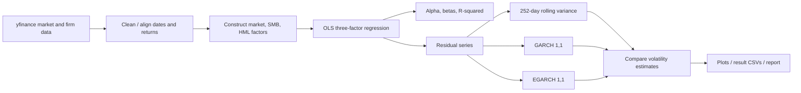

### Estimation-to-volatility sequence

```mermaid
sequenceDiagram
    participant D as Historical data
    participant F as Factor construction
    participant O as OLS
    participant V as Volatility models
    D->>F: Daily prices, market caps, valuation data
    F->>F: Calculate factor portfolio returns
    F->>O: Stock excess returns + MKT, SMB, HML
    O-->>V: Regression residuals
    V->>V: Rolling variance; GARCH and EGARCH
    V-->>D: Compare persistence and asymmetry
```

### Equations worth memorizing

**Fama-French three-factor regression:**

$$
R_{i,t}-R_{f,t}=\alpha_i+\beta_M(R_{M,t}-R_{f,t})+\beta_S SMB_t+\beta_H HML_t+\varepsilon_{i,t}
$$

`SMB = Small Minus Big` portfolio return. `HML = High Minus Low` book-to-market value factor. `ε` is the part not explained by these factors. The project README discusses a price-to-book based sorting rule; be ready to clarify whether high **P/B** has been appropriately inverted to mean high **book-to-market** when constructing HML.

**GARCH(1,1) conditional variance:**

$$
\sigma_t^2=\omega+\alpha\varepsilon_{t-1}^2+\beta\sigma_{t-1}^2
$$

**README-claimed sample:** For `RELIANCE.NS`, `β_M≈1.0256`, `β_SMB≈-0.211`, `β_HML≈0.3116`, `R²≈0.516`; GARCH `α=0.05`, `β=0.93`, so `α+β=0.98`. Treat these as reported sample results, **not universal market statistics**.

### Most anticipated project-defense questions

**Q1. 🔥 What was the objective?**  
**Answer:** Explain excess stock returns using market, size and value factors, then study whether the unexplained return component exhibits time-varying volatility.

**Q2. What does the market factor mean?**  
**Answer:** `R_M − R_f` is market return above the risk-free rate. Its beta estimates how sensitively a stock's excess return responds to the broad market.

**Q3. What are SMB and HML?**  
**Answer:** SMB captures small-minus-large company return differences. HML captures high-minus-low **book-to-market** return differences. These are factor-mimicking portfolio returns, not raw stock features.

**Q4. 🔥 How do you estimate the betas?**  
**Answer:** Perform OLS regression of daily stock excess return on the three factor returns with an intercept. Betas minimize the sum of squared residuals.

**Q5. What is alpha?**  
**Answer:** The regression intercept: average excess return unexplained by included factors, under the model. Estimate and test it rather than assuming statistical significance from its numerical value.

**Q6. 🔥 What does R² = 0.516 mean?**  
**Answer:** In the reported sample regression, roughly 51.6% of **variation in dependent excess returns** is explained in-sample by the included factors. It does not mean 51.6% of future returns are predicted correctly.

**Q7. Why model residuals instead of raw returns?**  
**Answer:** After removing common market/size/value exposures, residuals focus the volatility model on remaining idiosyncratic or unexplained movements.

**Q8. What is heteroskedasticity?**  
**Answer:** Error variance changes across observations/time. Financial returns often show volatility clustering, motivating conditional-variance models.

**Q9. 🔥 Explain GARCH(1,1).**  
**Answer:** Today's conditional variance depends on a baseline, yesterday's squared shock and yesterday's conditional variance. It models persistence of volatility rather than constant noise.

**Q10. What does α + β near 1 indicate?**  
**Answer:** Strong persistence: after a volatility shock, conditional variance decays slowly. In the README example the sum is 0.98; for usual stationary GARCH(1,1) assumptions we generally require α + β below 1.

**Q11. Why use EGARCH?**  
**Answer:** EGARCH models log variance and allows shock sign/asymmetry effects: positive and negative returns of similar size can influence volatility differently. Ordinary symmetric GARCH does not explicitly capture this asymmetry.

**Q12. What is rolling variance?**  
**Answer:** Compute sample variance over a moving fixed window—**252 trading days** in the README. It is simple but assigns equal weight within the window and reacts differently from conditional models.

**Q13. 🔥 What is look-ahead bias in factor construction?**  
**Answer:** Using company size, valuation or index membership data not actually known on a portfolio formation date contaminates historical results. Use point-in-time available information and rebalance chronologically.

**Q14. Why are missing data and survivorship bias important?**  
**Answer:** Restricting analysis to surviving/current index constituents can overstate historical performance; missing values and corporate actions can distort returns. Use adjusted prices and period-appropriate universes where possible.

**Q15. Are the regressions causal?**  
**Answer:** No. Factor regression quantifies statistical co-movement and exposures under a model; it does not prove the factors individually cause returns.

**Q16. How would you evaluate a volatility forecast out-of-sample?**  
**Answer:** Fit on historical periods, forecast future conditional variance, and compare against subsequent realized-volatility proxies using metrics like QLIKE/forecast error. Keep train/test chronology intact.

**Q17. What are the limitations?**  
**Answer:** Factor definitions and universe selection, small sample, data quality, instability of coefficients, misspecification and volatility model assumptions. A good next step is walk-forward out-of-sample evaluation.

**Q18. What numerical result can you discuss?**  
**Answer:** The README reports `β_M≈1.0256`, negative SMB exposure, positive HML exposure and `R²≈0.516` for a sample stock, plus highly persistent GARCH conditional variance. Describe them as **sample fitted estimates** and explain their interpretation.

### Traps to avoid

- Distinguish **price-to-book** from **book-to-market**; conventional HML is formed from book-to-market. Be ready to examine the actual notebook factor code.
- `README-CLAIM`: model coefficients and output statistics; do not assert you independently cross-validated them without checking notebook/results.
- Do not confuse predicting **conditional volatility** with predicting the **direction of returns**.

---

# Project 7 — Reinforcement Learning Capstone

**Repository:** https://github.com/piyush0028/Reinforcement-Learning-Capstone  
**Stack verified:** Python, NumPy, PyTorch, a simulated OBELIX robot environment, training/evaluation scripts across multiple rounds, DQN-family and other baseline experiments. Inspected **Round 3/week 1** training agent uses **Dueling Double DQN (DDQN)** with 32-frame state stacking.

### 45–60-second introduction

> "For a reinforcement-learning capstone, I trained agents to control the simulated OBELIX robot. The agent receives sensor observations, chooses among five movement actions, and learns to maximize reward as it navigates and interacts with a box. I experimented across successive rounds with value-based methods; the inspected later-stage implementation uses a Dueling Double DQN, replay memory, a target network, epsilon-greedy exploration, observation history and reward shaping. The challenging parts are sparse feedback, partial observability and robust evaluation across randomized environments."

### RL training architecture — inspected later-stage implementation

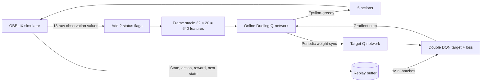

### One training interaction

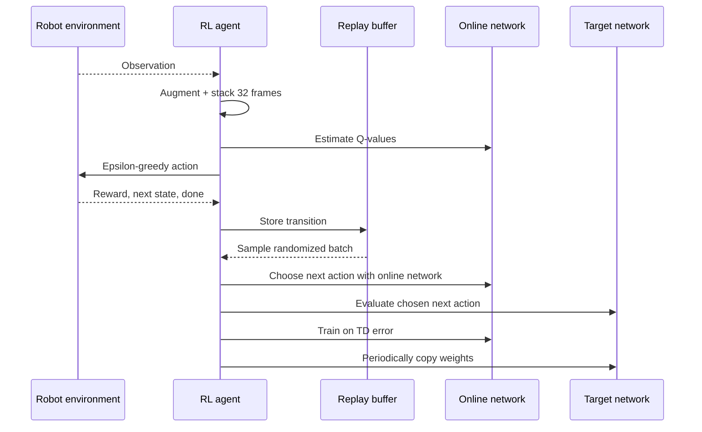

### Important implementation references

- [Later-stage Dueling DDQN model and policy](https://github.com/piyush0028/Reinforcement-Learning-Capstone/blob/master/Round%203/week%201/CS780-OBELIX/agent.py)
- [Phase-3 training, replay buffer and hyperparameters](https://github.com/piyush0028/Reinforcement-Learning-Capstone/blob/master/Round%203/week%201/CS780-OBELIX/train_phase3.py)
- [Evaluation script](https://github.com/piyush0028/Reinforcement-Learning-Capstone/blob/master/Round%203/week%201/CS780-OBELIX/evaluate.py)
- [Earlier DDQN experiment](https://github.com/piyush0028/Reinforcement-Learning-Capstone/blob/master/Round%201/week%201/CS780-OBELIX/train_ddqn.py)
- [Project environment instructions](https://github.com/piyush0028/Reinforcement-Learning-Capstone/blob/master/Round%203/week%201/CS780-OBELIX/README.md)

### Formulas worth memorizing

**Q-learning intuition:**

$$
Q(s,a) \leftarrow Q(s,a)+\alpha[r+\gamma\max_{a'}Q(s',a')-Q(s,a)]
$$

**Double DQN target (nonterminal):**

$$
y=r+\gamma Q_{\mathrm{target}}\big(s',\arg\max_{a'}Q_{\mathrm{online}}(s',a')\big)
$$

For terminal transitions, remove the bootstrap term. **Dueling Q-network:**

$$
Q(s,a)=V(s)+A(s,a)-\frac{1}{|\mathcal A|}\sum_{a'} A(s,a')
$$

### Most anticipated project-defense questions

**Q1. 🔥 What are state, action and reward in your project?**  
**Answer:** State is a processed history of robot sensor observations; actions are five discrete movement commands (`L45`, `L22`, `FW`, `R22`, `R45`); rewards signal progress and task outcomes in the simulator.

**Q2. What is an MDP?**  
**Answer:** A Markov Decision Process specifies states, actions, transition probabilities, rewards and discount factor; the next state depends on the current state/action under the Markov assumption.

**Q3. Why stack observations?**  
**Answer:** A single sensor reading may not reveal motion or hidden context. Recent history helps estimate temporal changes in a partially observed environment.

**Q4. 🔥 What exactly is the input dimension?**  
**Answer:** The inspected phase-3 code starts with **18 sensor values**, appends **two flags**, and stacks **32** observations: `20 × 32 = 640` features.

**Q5. What is DQN?**  
**Answer:** Deep Q-Network approximates action values with a neural net rather than a lookup table, learning from bootstrapped targets sampled from experience.

**Q6. 🔥 Why Double DQN?**  
**Answer:** Using the online network to **select** the next action and a target network to **evaluate** it reduces overestimation bias from using a single max over noisy estimates.

**Q7. What is the dueling architecture?**  
**Answer:** A common feature extractor branches into state-value `V(s)` and action-advantage `A(s,a)` streams; their normalized combination produces Q-values.

**Q8. What is experience replay?**  
**Answer:** Store transitions `(s,a,r,s',done)` and train on randomly sampled mini-batches. This reuses past experience and reduces correlation between consecutive updates.

**Q9. Why keep a target network?**  
**Answer:** Bootstrapping on a moving prediction target can destabilize training. A periodically copied target network changes more slowly.

**Q10. 🔥 What hyperparameters are in the inspected phase-3 training script?**  
**Answer:** `gamma=0.99`, `learning rate=1e-4`, `batch size=128`, `replay capacity=200,000`, `target sync=1,000 steps`, `epsilon=0.20` decaying toward `0.03` (per source script).

**Q11. How does epsilon-greedy exploration work?**  
**Answer:** With probability epsilon, choose a random action; otherwise choose the action with highest predicted Q-value. Decaying epsilon gradually shifts from exploration to exploitation.

**Q12. What is reward shaping?**  
**Answer:** Add intermediate signals (e.g., making progress or avoiding useless movement) to help sparse-reward learning. Poorly designed shaping can reward exploiting shortcuts instead of completing the true task.

**Q13. What is discount factor gamma?**  
**Answer:** It downweights future rewards: a reward received `k` steps later contributes roughly `γ^k`. The value 0.99 makes the agent relatively future-oriented.

**Q14. Why train multiple rounds?**  
**Answer:** To test progressively harder environments/observations and improve robustness. The repository contains separate Round 1/2/3 training and submission directories; don't infer guaranteed benchmark improvement without measured comparisons.

**Q15. 🔥 How do you evaluate a reinforcement-learning agent reliably?**  
**Answer:** Test across multiple random seeds and environment configurations, report mean/std return and success rates, and compare to simple policies on the **same** evaluation protocol.

**Q16. What causes overestimation bias in vanilla DQN?**  
**Answer:** The max over noisy estimated Q-values tends to prefer positively biased estimates. Double DQN decouples selection from evaluation.

**Q17. What are the disadvantages of replay buffers?**  
**Answer:** Memory costs, stale/off-policy experiences and sampling bias; prioritize replay only with careful correction/validation.

**Q18. What is overfitting in RL?**  
**Answer:** An agent learns quirks of a few seeds/maps but fails on new layouts. Randomized training environments, independent held-out seeds and varied difficulty assess generalization.

**Q19. What can go wrong with a global stateful `policy` function?**  
**Answer:** The inspected inference agent retains module-level frame history, step counter and previous flags. If several episodes/robots share one process without independent state/reset, histories can leak between runs.

**Q20. What is your most important improvement?**  
**Answer:** Quantify success per difficulty/seed, validate reward shaping against the real task, isolate per-episode agent state, and compare Double DQN to simpler baselines with ablations.

### Traps to avoid

- `IMPLEMENTED`: inspected **phase-3** training is Dueling Double DQN; other earlier folders contain alternative experiments. Do not call **every file** the same algorithm.
- Do not claim a world-leading score, a specific win rate or best hyperparameters without evaluation artifacts.
- A neural value function estimates discounted expected return—not the probability that an action is good.

---
# Tech-stack interview question bank

> This is the **shared fundamentals section**. Study the questions below whenever the corresponding technology appears in your project. The answers are deliberately short enough to say aloud in an interview; add your own concrete project example.

## A. JavaScript and TypeScript — SnipLink, Order Book, React projects

**JS1. 🔥 What is JavaScript?**  
**Answer:** A dynamically typed language widely used in browsers and Node.js. Its execution model includes a call stack and asynchronous task scheduling.

**JS2. 🔥 What is asynchronous JavaScript?**  
**Answer:** It lets I/O operations progress without blocking the main execution thread. Completion handlers run later through promises/callbacks and the event loop; it does **not** mean every operation executes in parallel.

**JS3. 🔥 How does the event loop work?**  
**Answer:** JavaScript runs synchronous code on the call stack. When it becomes free, queued tasks are processed; promise microtasks generally run before the next task such as a timer callback.

**JS4. 🔥 What is a closure?**  
**Answer:** A function that retains access to its lexical variables even after the outer function has returned. It is used for encapsulation, callbacks and memoization.

```javascript
function makeCounter() {
  let count = 0;
  return () => ++count;
}
const next = makeCounter();
next(); // 1
next(); // 2
```

**JS5. `var` vs `let` vs `const`?**  
**Answer:** `var` is function-scoped and hoisted with `undefined`; `let`/`const` are block-scoped with a temporal dead zone. `const` prevents rebinding but not mutation of object contents.

**JS6. What is hoisting?**  
**Answer:** Declarations are processed before statement execution; function declarations are callable early, while `let`/`const` cannot be accessed before initialization.

**JS7. `==` vs `===`?**  
**Answer:** `==` allows type coercion; `===` compares without type conversion. Prefer strict equality unless coercion is intentional.

**JS8. What is a Promise?**  
**Answer:** A container representing the eventual success or failure of an asynchronous operation. It has pending, fulfilled and rejected states.

**JS9. 🔥 What do `async` and `await` do?**  
**Answer:** An `async` function returns a Promise. `await` pauses that function's continuation until the awaited promise settles, without blocking the entire event loop.

**JS10. `Promise.all` vs `Promise.allSettled`?**  
**Answer:** `all` resolves when all succeed and rejects when any rejects; `allSettled` waits for every promise and returns each outcome.

**JS11. Microtask vs macrotask?**  
**Answer:** Promise `.then`/`await` continuations are microtasks; timers are tasks/macrotasks. Microtasks are drained before moving to the next task in normal event-loop processing.

**JS12. What is `this` in JavaScript?**  
**Answer:** In a regular function it depends on how the function is called; arrows lexically capture `this` from the surrounding scope.

**JS13. What is destructuring?**  
**Answer:** Syntax to extract values from arrays/objects into variables, e.g. `const {price} = trade;`.

**JS14. Shallow vs deep copy?**  
**Answer:** Shallow copy duplicates only outer references; nested objects remain shared. Deep copy duplicates nested structures too, with limitations depending on method.

**JS15. `map`, `filter`, `reduce`?**  
**Answer:** `map` transforms elements; `filter` keeps matching ones; `reduce` combines a collection into an accumulated result. In Researcher search, `filter` selects matching cards.

**JS16. What is debouncing vs throttling?**  
**Answer:** Debouncing delays an action until activity stops (search input); throttling limits how often an action can run (high-frequency display refresh).

**JS17. What is TypeScript?**  
**Answer:** JavaScript with a static type system and compiler checks; type annotations are erased when compiled to JavaScript. It improves tooling but does not validate API payloads at runtime.

**JS18. `interface` vs `type`?**  
**Answer:** Both describe shapes. Interfaces support declaration merging; type aliases also express unions, primitives and mapped types. Use whichever best expresses the contract.

**JS19. What are `unknown` and `any`?**  
**Answer:** `any` bypasses checks; `unknown` requires narrowing before use and is safer for untrusted inputs.

**JS20. 🔥 Why validate input if TypeScript already has types?**  
**Answer:** Types disappear at runtime. External JSON, form inputs and database data still need runtime validation, e.g. with Zod or Pydantic.

## B. React and Next.js — all web frontends

**RE1. 🔥 What is React?**  
**Answer:** A JavaScript library for building declarative UIs from reusable components. State/props determine what a component renders; React reconciles changes with the DOM.

**RE2. What is JSX?**  
**Answer:** A syntax extension for describing component trees in JavaScript. Tooling transforms JSX into JavaScript element creation calls.

**RE3. What are props?**  
**Answer:** Inputs a parent passes to a child component. They are conceptually read-only within the child.

**RE4. What is state?**  
**Answer:** Data owned by a component that can change and trigger rerenders—for example order-book levels or a search query.

**RE5. 🔥 `useState` vs `useRef`?**  
**Answer:** `useState` stores render-visible values and triggers rerenders when updated. `useRef` persists a mutable reference across renders without triggering a rerender.

**RE6. 🔥 What does `useEffect` do?**  
**Answer:** Runs synchronization logic after rendering, commonly for subscriptions, timers and browser APIs. Return cleanup to unsubscribe, close sockets or cancel timers.

**RE7. Why cleanup a WebSocket in `useEffect`?**  
**Answer:** Without cleanup, unmounted components may leave open connections/timers and duplicate events after remounting.

**RE8. What is the Virtual DOM?**  
**Answer:** React's in-memory representation of the desired UI. React compares render outputs to determine efficient DOM updates; it is not a guarantee of minimal work.

**RE9. What causes a rerender?**  
**Answer:** State changes, parent rerenders, context updates or external-store updates. A rerender does not necessarily mean a DOM mutation.

**RE10. Why are React list keys important?**  
**Answer:** Keys identify sibling elements across updates and help preserve their state. Prefer stable unique IDs over indexes for reorderable lists.

**RE11. What is prop drilling?**  
**Answer:** Passing data through intermediate components that don't need it. Context or a global store may help for genuinely shared state.

**RE12. `useMemo` vs `useCallback`?**  
**Answer:** `useMemo` caches a calculated value; `useCallback` caches a function reference. Both are optimizations only when dependencies and measurements justify them.

**RE13. What is a controlled input?**  
**Answer:** An input whose value is driven by React state and whose change handler updates that state—for example the CRAG question field.

**RE14. What is reconciliation?**  
**Answer:** React determines how to update an existing UI tree in response to new element descriptions, considering component types and keys.

**RE15. 🔥 CSR vs SSR vs SSG?**  
**Answer:** CSR renders primarily in the browser; SSR generates HTML for a request on the server; SSG generates HTML ahead of requests during build/controlled revalidation. Each trades freshness, performance and infrastructure costs.

**RE16. What is hydration?**  
**Answer:** React makes server-rendered HTML interactive on the client. Initial server/client markup should be consistent to avoid mismatches.

**RE17. What is Next.js?**  
**Answer:** A React framework offering routing, server rendering, build optimizations, data-fetching patterns, metadata and deployment conventions.

**RE18. 🔥 What are Server and Client Components in Next.js App Router?**  
**Answer:** Server Components run server-side and can access server resources; Client Components opt into browser-side state, effects and event handlers with `"use client"`.

**RE19. How does file-based routing work?**  
**Answer:** `app/page.tsx` maps to `/`, `app/search/page.tsx` to `/search`, and `app/researcher/[id]/page.tsx` to a dynamic researcher route.

**RE20. What are layouts in Next.js?**  
**Answer:** Shared UI wrappers for nested routes. They can preserve navigation/header structure as users move through pages.

**RE21. What is dynamic import/code splitting?**  
**Answer:** Loading a module only when required rather than including it in an initial bundle; helpful for heavy charts, animations and browser-only widgets.

**RE22. How does Next.js help SEO?**  
**Answer:** Server-rendered content, metadata APIs, meaningful routes and image optimization can improve discoverability and presentation to crawlers.

**RE23. What is a hydration mismatch?**  
**Answer:** Server-generated markup differs from the initial browser render, often due to nondeterminism (`Date.now()`, browser APIs, conditional localStorage). Fix by making first renders deterministic or deferring browser work.

**RE24. When should you use Zustand/React Query?**  
**Answer:** Zustand for shared client-state patterns; TanStack Query for asynchronous server-state caching, retries and invalidation. Avoid claiming either is actively used just because it is in dependencies.

**RE25. What is React Strict Mode's development behavior?**  
**Answer:** It may replay render/effect setup and cleanup to reveal unsafe side effects. Effects and socket setup should remain correctly cleanup-safe.

## C. Node.js, Express, REST and HTTP — SnipLink/backend projects

**N1. 🔥 Is Node.js single-threaded?**  
**Answer:** JavaScript handlers run on a main event-loop thread by default; Node also uses OS/network async I/O and libuv worker threads for some operations. CPU-heavy synchronous JS can still block requests.

**N2. What is Express?**  
**Answer:** A minimal Node.js web framework for HTTP routing and middleware. SnipLink uses controller/service/repository-style modules.

**N3. 🔥 What is middleware?**  
**Answer:** A function that inspects/modifies a request or response and passes control onward (`next()`) or ends the request. Common uses: auth, validation, logging and rate limiting.

**N4. What is REST?**  
**Answer:** A resource-oriented architectural style using HTTP methods, representations and stateless requests. It's not simply 'any JSON API'.

**N5. GET vs POST vs PUT vs PATCH vs DELETE?**  
**Answer:** GET reads; POST creates/processes; PUT replaces a resource representation; PATCH partially modifies; DELETE removes/deactivates. Actual endpoint semantics should be documented.

**N6. 🔥 What is idempotency?**  
**Answer:** Performing the same operation multiple times has the same intended effect as once. PUT/DELETE are designed to be idempotent; POST often needs an idempotency key for safe retries.

**N7. Important HTTP statuses?**  
**Answer:** `200 OK`, `201 Created`, `204 No Content`, `301/302 Redirect`, `400 Bad Request`, `401 Unauthenticated`, `403 Forbidden`, `404 Missing`, `409 Conflict`, `429 Rate Limited`, `500 Server Error`.

**N8. 401 vs 403?**  
**Answer:** 401 means missing/invalid authentication; 403 means identity is understood but access is not permitted.

**N9. 301 vs 302?**  
**Answer:** 301 is a permanent redirect and may be cached persistently; 302 is temporary. SnipLink uses 302 so destination changes are less problematic.

**N10. How do you handle errors in async Express handlers?**  
**Answer:** Propagate exceptions to centralized error middleware (`next(error)` in the current controller) and return consistent status codes; never silently swallow critical failures.

**N11. What is a controller-service-repository pattern?**  
**Answer:** Controller handles HTTP, service owns business logic, repository handles persistence. It separates concerns and makes testing easier.

**N12. What is an ORM?**  
**Answer:** A tool that maps application models/operations to database queries. Prisma generates typed client methods; it does not eliminate SQL knowledge or performance considerations.

**N13. What is CORS?**  
**Answer:** A browser policy/protocol controlling whether a cross-origin web page can read HTTP responses. CORS is not user authorization and does not block arbitrary non-browser clients.

**N14. What is a load balancer?**  
**Answer:** Distributes traffic across healthy service instances. Stateless APIs can scale horizontally when persistent state is stored in shared systems.

**N15. What is p95 latency?**  
**Answer:** 95% of measured requests complete at or below that latency. It captures user-facing tail behavior better than average latency alone.

## D. PostgreSQL, SQL and Prisma — SnipLink, database design discussions

**DB1. 🔥 Why PostgreSQL for URLs?**  
**Answer:** ACID transactions, unique constraints, indexes, relationships and SQL analytics fit durable users, URLs and click records.

**DB2. What is a primary key?**  
**Answer:** A column or combination of columns uniquely identifying a row; PostgreSQL enforces uniqueness and non-nullness.

**DB3. Unique constraint vs primary key?**  
**Answer:** Both can enforce uniqueness, but a table has one primary key, which cannot contain nulls. Multiple unique constraints are allowed, with nuanced null behavior.

**DB4. 🔥 What is a database index?**  
**Answer:** An auxiliary data structure (commonly B-tree) that speeds suitable searches at the expense of storage and slower writes/maintenance.

**DB5. What is a composite index?**  
**Answer:** Index over multiple columns. A `(urlId, clickedAt)` index suits filtering by URL and then time range; leftmost-prefix behavior matters for common B-tree plans.

**DB6. What is ACID?**  
**Answer:** Atomicity, Consistency, Isolation and Durability—properties governing reliable transactions.

**DB7. What are isolation levels?**  
**Answer:** Rules determining which concurrent changes a transaction can observe. Common SQL levels include Read Committed, Repeatable Read and Serializable, with database-specific behavior.

**DB8. 🔥 What is a race condition for custom aliases?**  
**Answer:** Two requests can both observe that an alias is available. Only a database `UNIQUE` constraint ensures one insert wins; convert the constraint failure into HTTP 409.

**DB9. What is a transaction?**  
**Answer:** A group of database operations committed or rolled back as one unit; essential when several writes must succeed together.

**DB10. What is database normalization?**  
**Answer:** Organizing relations to reduce redundancy and update anomalies, typically separating logical entities and connecting them via foreign keys.

**DB11. INNER JOIN vs LEFT JOIN?**  
**Answer:** INNER returns matching rows only; LEFT includes all rows from the left table and nulls for missing right matches.

**DB12. WHERE vs HAVING?**  
**Answer:** WHERE filters rows before grouping; HAVING filters groups after aggregation.

**DB13. 🔥 How would you count clicks per day?**  
**Answer:** Filter events for a URL, group timestamps by day and count rows. SnipLink's analytics repository uses `DATE_TRUNC('day', "clickedAt")`.

```sql
SELECT DATE_TRUNC('day', "clickedAt") AS day, COUNT(*) AS clicks
FROM click_events
WHERE "urlId" = $1
GROUP BY day
ORDER BY day;
```

**DB14. OFFSET pagination vs keyset pagination?**  
**Answer:** OFFSET is simple but costly and unstable at large offsets with inserts; keyset uses the last seen ordered key for efficient, stable paging.

**DB15. Why might `COUNT(*)` become costly?**  
**Answer:** Large filtered scans need work; appropriate indexes, aggregates or approximate counters may help at scale depending on consistency requirements.

**DB16. What is N+1 query problem?**  
**Answer:** Fetching one parent list then a separate query for each related row. Solve with joins, batching, prefetching or ORM relation loading.

**DB17. What is a migration?**  
**Answer:** A versioned database schema change, such as adding tables/columns/indexes. Prisma migrations help align application schema and database state.

**DB18. What is a foreign key?**  
**Answer:** A constraint relating referenced records and preserving referential integrity. `ClickEvent.urlId` references a URL in SnipLink's Prisma model.

**DB19. How would you optimize a slow SQL query?**  
**Answer:** Inspect `EXPLAIN ANALYZE`, identify scans/sorts/joins, add suitable indexes, reduce selected data and measure the change with real workloads.

**DB20. What is a connection pool?**  
**Answer:** A reusable set of DB connections; prevents connection setup per request and caps concurrency, but oversized pools can overload PostgreSQL.

## E. Redis, caching and RabbitMQ — SnipLink

**R1. 🔥 What is Redis?**  
**Answer:** An in-memory data store supporting strings, hashes, sorted sets and more. Often used for caching, rate limits, counters and short-lived coordination.

**R2. Cache-aside vs write-through?**  
**Answer:** Cache-aside explicitly checks cache then DB on miss and updates/invalidate cache after DB writes. Write-through updates cache through a write path synchronously with storage.

**R3. 🔥 What is cache invalidation?**  
**Answer:** Removing/refreshing cached entries when authoritative data changes. SnipLink invalidates a short URL after update/soft delete.

**R4. What is TTL?**  
**Answer:** Time to live: how long an item may remain cached. TTL bounds staleness and limits memory growth but increases misses when short.

**R5. What is a cache stampede?**  
**Answer:** Many concurrent misses on the same hot key overload the origin database. Mitigate with request coalescing, locks, jitter or stale-while-revalidate where appropriate.

**R6. What is negative caching?**  
**Answer:** Cache absence/errors briefly so repeated invalid lookups don't repeatedly hit persistent storage.

**R7. What is an LRU policy?**  
**Answer:** Least Recently Used evicts the least recently accessed items; Redis supports configurable approximations and other policies.

**R8. 🔥 Fixed-window vs sliding-window rate limiting?**  
**Answer:** Fixed windows reset at boundaries and allow bursts around a boundary. Sliding windows count recent requests continuously and smooth bursts.

**R9. Why use Redis sorted sets for limiting?**  
**Answer:** Score each request by timestamp, delete entries older than the window and count remaining entries.

**R10. Why Lua for rate limiting?**  
**Answer:** Atomic multi-command checks avoid races when many requests hit the same key simultaneously.

**R11. What is RabbitMQ?**  
**Answer:** A message broker for producer/consumer communication using queues and routing. It decouples request handling from slower background processing.

**R12. 🔥 What is ACK vs NACK?**  
**Answer:** ACK confirms successful processing; NACK indicates failure and can reject or requeue depending on flags. Correct handling matters for retries and delivery guarantees.

**R13. What is `prefetch(1)`?**  
**Answer:** Limit one unacknowledged message at a time per consumer channel (under common settings); simplifies flow control but may restrict throughput.

**R14. At-most-once vs at-least-once vs exactly-once?**  
**Answer:** At-most-once can lose messages; at-least-once can duplicate; end-to-end exactly-once effects generally require additional transactional/deduplication design beyond broker ACKs.

**R15. 🔥 What is idempotent consumer processing?**  
**Answer:** Reprocessing the same event doesn't create duplicate side effects. Give each click an ID and enforce unique insertion or record processed IDs transactionally.

**R16. What is a dead-letter queue?**  
**Answer:** A destination for messages that cannot be processed after configured retry/rejection policies, enabling inspection and repair.

**R17. What is an outbox pattern?**  
**Answer:** Write business state and a pending event in one DB transaction; separately publish the event and mark it delivered. This reduces data/event inconsistency on producer crashes.

**R18. How do you handle a Redis hot key?**  
**Answer:** Measure throughput, avoid unnecessarily large values, allow in-process caching where safe, and consider replication or different keying patterns before blindly sharding.

**R19. What happens if message order changes?**  
**Answer:** Business logic must tolerate it or enforce per-key ordering; click counts often can be unordered, but state transition events may need sequence IDs.

**R20. What is producer confirmation?**  
**Answer:** Broker acknowledgement that a published message was accepted under configured durability; it is distinct from a consumer's processing ACK.

## F. Authentication, authorization and web security — SnipLink, Researcher Aggregation

**SEC1. 🔥 Authentication vs authorization?**  
**Answer:** Authentication proves **who** someone is; authorization determines **what** they may do. Example: login versus permission to edit another user's URL.

**SEC2. What is JWT?**  
**Answer:** A compact token format with header, claims and signature. A valid signature establishes issuer integrity if verified correctly; JWT payloads are generally **encoded, not encrypted**.

**SEC3. Access token vs refresh token?**  
**Answer:** Access tokens authorize API calls and are usually short-lived; refresh tokens renew sessions and require stronger storage/revocation controls.

**SEC4. What is refresh-token rotation?**  
**Answer:** Replace a refresh token on each use and invalidate the old one; detecting old-token reuse can signal compromise.

**SEC5. What is bcrypt?**  
**Answer:** An adaptive password-hashing algorithm with salts and configurable work factor, designed to make offline guessing costly.

**SEC6. What is OAuth2?**  
**Answer:** A framework for delegated authorization through an authorization server; in ORCID login, the app follows an authorization-code based identity flow.

**SEC7. What is the authorization code in OAuth2?**  
**Answer:** A short-lived value the backend exchanges for tokens. It should be single-use and bound to the correct app/redirect.

**SEC8. What is OAuth state?**  
**Answer:** An unpredictable value bound to a login initiation and validated on callback to help prevent CSRF/login mix-up attacks.

**SEC9. Why store auth secrets in environment variables?**  
**Answer:** Keep credentials out of source control and rotate them without changing code; production secret managers add access control and auditability.

**SEC10. 🔥 HttpOnly cookie vs localStorage JWT?**  
**Answer:** HttpOnly cookies prevent JS from reading token contents but require CSRF-aware design; localStorage is accessible to injected JS. Neither automatically solves all web security problems.

**SEC11. What is XSS?**  
**Answer:** Injected client-side code executing under a trusted origin. Escape untrusted content, avoid dangerous HTML sinks and use CSP plus safe frameworks.

**SEC12. What is CSRF?**  
**Answer:** A malicious site causes a victim's browser to send an authenticated cross-site request. SameSite, tokens and origin checks mitigate relevant flows.

**SEC13. What is CORS *not*?**  
**Answer:** CORS is not identity verification, authorization or a firewall; a non-browser client can call public endpoints regardless of a browser CORS restriction.

**SEC14. What is RBAC?**  
**Answer:** Role-based access control maps users to roles and roles to permissions; enforce access checks on the backend, never only in the UI.

**SEC15. Why can Base62 short codes be a security risk?**  
**Answer:** Sequential IDs can be enumerated, revealing accessible public URLs. Protect sensitive resources independently; opacity is not authorization.

## G. WebSockets, networking and real-time systems — Order Book

**WS1. 🔥 What is a WebSocket?**  
**Answer:** A persistent full-duplex connection established through an HTTP upgrade (in common HTTP/1.1 setups), allowing both sides to send messages over one connection.

**WS2. WebSocket vs HTTP polling?**  
**Answer:** WebSocket pushes frequent events through one connection; polling repeatedly requests state. Polling is simpler but can waste requests and add latency.

**WS3. WebSocket vs Server-Sent Events (SSE)?**  
**Answer:** SSE streams server→client text events over HTTP; WebSocket is bidirectional and supports binary frames. Pick based on whether bidirectional exchange is necessary.

**WS4. What is a WebSocket handshake?**  
**Answer:** Client requests a protocol switch, server agrees, and communication continues as WebSocket frames on the established connection.

**WS5. 🔥 How does reconnection work?**  
**Answer:** Detect close/error, cancel obsolete sockets, wait, reconnect and restore subscriptions. Use exponential backoff with jitter and re-fetch authoritative state if events might be missed.

**WS6. What is heartbeat/ping-pong?**  
**Answer:** Periodic messages detect broken or idle connections that haven't produced a clean close event.

**WS7. What is message ordering?**  
**Answer:** TCP preserves byte order within one live connection, but application event sequences across reconnects/sources may have gaps or stale messages; sequence IDs detect them.

**WS8. What is a snapshot + delta feed?**  
**Answer:** Snapshot gives the complete starting state; deltas modify it. Apply ordered deltas only after synchronizing them to snapshot update IDs.

**WS9. What is backpressure?**  
**Answer:** Producers generate events faster than consumers can process them. Bound buffers, batch processing or reduce refresh rates so memory/latency do not grow indefinitely.

**WS10. 🔥 What is an order-book crossed market?**  
**Answer:** When best bid exceeds best ask, which usually flags inconsistent feed handling in an ordinary continuous matching book, aside from special exchange states. Validate feed synchronization.

**WS11. What is network latency vs processing latency?**  
**Answer:** Network latency is data transit delay; processing latency is decode/update/render time. Measure separately before optimizing React.

**WS12. Why not put every market event in React component state?**  
**Answer:** Extremely frequent events create rerender pressure. Keep an up-to-date mutable model and render at a bounded cadence, without losing feed correctness.

## H. Python, FastAPI and async I/O — CRAG and Researcher backend

**PY1. What is Python?**  
**Answer:** A high-level, dynamically typed language commonly used for APIs, data work, machine learning and scripting.

**PY2. 🔥 What is FastAPI?**  
**Answer:** A Python ASGI web framework using type annotations and Pydantic for request validation, automatic API documentation and async-capable routes.

**PY3. What is Pydantic?**  
**Answer:** A data validation/modeling library. It parses and validates external request data at runtime, unlike TypeScript types which disappear after compilation.

**PY4. `async def` vs `def` in FastAPI?**  
**Answer:** Use `async def` for nonblocking awaitable operations; blocking synchronous work inside it can stall the event loop. Ordinary synchronous route functions can be run in a threadpool by the framework.

**PY5. 🔥 What is blocking I/O?**  
**Answer:** An operation holding up its execution thread until it completes. In CRAG, synchronous model/database SDK calls inside an async endpoint can affect concurrency.

**PY6. What is Uvicorn?**  
**Answer:** An ASGI server that runs async Python web applications like FastAPI.

**PY7. What is an API request schema?**  
**Answer:** A declared structure for input/output, e.g. CRAG's Pydantic `QueryRequest` with a `question: str` field.

**PY8. How should APIs handle timeouts?**  
**Answer:** Set reasonable per-service deadlines, surface controlled errors, retry only safe requests with bounded backoff, and monitor dependency failures.

**PY9. What is a Python virtual environment?**  
**Answer:** A separate package environment avoiding conflicts with global Python dependencies and between projects.

**PY10. What are decorators in Python?**  
**Answer:** Functions/classes that wrap or modify a function/class; FastAPI `@app.get`/`@app.post` register request handlers.

**PY11. What is the Python GIL?**  
**Answer:** In traditional CPython builds, the Global Interpreter Lock restricts simultaneous execution of Python bytecode across threads; I/O concurrency and native extensions can still perform useful work, and newer builds may differ.

**PY12. What is the difference between threading, multiprocessing and async?**  
**Answer:** Threads share process memory; processes have separate memory and can use multiple CPU cores; async coordinates tasks at await points, especially for I/O.

## I. RAG, LLMs and vector search — CRAG

**AI1. 🔥 What are embeddings?**  
**Answer:** Learned numerical representations used to compare semantic similarity. Documents and queries must use compatible embedding spaces.

**AI2. What is cosine similarity?**  
**Answer:** Dot product divided by vector magnitudes; it measures alignment rather than absolute vector length.

**AI3. What is a vector database?**  
**Answer:** Stores vectors (and usually metadata) with efficient nearest-neighbor search. ChromaDB is the vector store used by the CRAG project.

**AI4. 🔥 What is chunking?**  
**Answer:** Splitting source documents into smaller coherent pieces before embedding. Chunk size affects retrieval precision, context sufficiency and indexing cost.

**AI5. What is top-k retrieval?**  
**Answer:** Return the `k` most similar/relevant candidates under the retrieval method. The checked CRAG API requests `n_results=2`.

**AI6. Dense vs sparse retrieval?**  
**Answer:** Dense uses embeddings; sparse retrieval uses lexical features like term frequencies/BM25. Combining them can improve coverage.

**AI7. What is a reranker?**  
**Answer:** A second-stage model that scores a small candidate set more precisely after initial retrieval, often improving relevance at extra latency.

**AI8. 🔥 What is hallucination?**  
**Answer:** A model produces unsupported or false content. Grounding prompts, references, refusal on insufficient evidence and independent evaluation help reduce it.

**AI9. What is prompt injection?**  
**Answer:** Untrusted retrieved text attempts to override the system's instructions or extract secrets. Do not treat documents as instructions; restrict tools and validate outputs.

**AI10. What is a context window?**  
**Answer:** The maximum sequence length of input/output tokens a model can handle in one inference request, subject to provider/model limits.

**AI11. What is temperature?**  
**Answer:** A sampling parameter that changes how sharply candidate token probabilities are distributed; lower temperature generally makes output more deterministic.

**AI12. What is recall@k?**  
**Answer:** A retrieval measure of how many relevant items were found among the top k, relative to total known relevant items.

**AI13. What is answer faithfulness?**  
**Answer:** Whether the answer's factual claims are supported by its retrieved context, separate from whether the underlying context is itself correct.

**AI14. Why are citations useful?**  
**Answer:** They let users verify the source supporting each factual claim and expose unsupported answers for auditing.

**AI15. 🔥 How do you design a RAG evaluation set?**  
**Answer:** Include answerable and unanswerable questions, paraphrases, contradictory documents, unseen entities and adversarial queries with human-verified evidence.

**AI16. What are latency/cost trade-offs in CRAG?**  
**Answer:** Embedding, first retrieval, evaluation, optional rewrite and generation each add external calls. Improve correctness only when the added cost/latency is justified by measured accuracy gains.

## J. Statistics, finance and econometrics — Fama-French

**FIN1. What is a return?**  
**Answer:** Simple return is `(P_t-P_(t-1))/P_(t-1)` (adjusted for distributions as appropriate); log return is `ln(P_t/P_(t-1))`.

**FIN2. What is excess return?**  
**Answer:** Asset return minus a risk-free return measured over the **same period**.

**FIN3. 🔥 What is OLS?**  
**Answer:** Ordinary Least Squares finds coefficients minimizing the sum of squared residuals; in matrix form, if conditions permit, `beta=(X'X)^(-1)X'y`.

**FIN4. What is multicollinearity?**  
**Answer:** Strong correlation among regressors makes coefficient estimates unstable and standard errors large, even if overall model fit looks reasonable.

**FIN5. What is residual vs fitted value?**  
**Answer:** Fitted value is the model prediction; residual is observed minus fitted. Volatility models in this project operate on regression residuals.

**FIN6. What is stationarity?**  
**Answer:** A process whose statistical properties are stable over time under the chosen definition; common GARCH assumptions require specific stability conditions.

**FIN7. 🔥 Why not use ordinary standard deviation only?**  
**Answer:** A single constant estimate ignores time-varying volatility and clustering; rolling variance/GARCH respond to changing conditional risk.

**FIN8. GARCH vs EGARCH?**  
**Answer:** GARCH directly models nonnegative conditional variance with lagged shocks/variance. EGARCH models log variance and can represent sign asymmetry.

**FIN9. What does beta above 1 mean?**  
**Answer:** Relative to the modeled market factor and holding other regressors fixed, the stock's excess returns tend to move more strongly than the market factor; it is not a guaranteed forecast.

**FIN10. In-sample vs out-of-sample?**  
**Answer:** In-sample evaluates on data used to fit; out-of-sample assesses generalization on later unseen data. Finance analysis is highly sensitive to leakage.

**FIN11. What is look-ahead bias?**  
**Answer:** Using future data or postdated information to construct historical signals, resulting in unrealistically good estimates/performance.

**FIN12. What is survivorship bias?**  
**Answer:** Looking only at securities that remain in a current universe and omitting those that disappeared, which skews historical conclusions.

## K. Machine learning and reinforcement learning — RL Capstone

**RL1. 🔥 Supervised vs reinforcement learning?**  
**Answer:** Supervised learning trains on labeled targets; RL learns actions from interaction and rewards, balancing short-term and long-term consequences.

**RL2. What is a policy?**  
**Answer:** A rule or probability distribution mapping a state/observation to an action.

**RL3. What is a value function?**  
**Answer:** Expected discounted return from a state under a policy; the action-value `Q(s,a)` additionally conditions on the chosen action.

**RL4. What is the Bellman equation?**  
**Answer:** It expresses a value as immediate reward plus discounted expected value of future states/actions.

**RL5. 🔥 What is Q-learning?**  
**Answer:** Off-policy temporal-difference learning that updates action values toward reward plus the discounted maximum next-action value.

**RL6. What is a TD error?**  
**Answer:** Difference between a bootstrapped target and current value estimate; minimizing it trains a DQN.

**RL7. What is a DQN?**  
**Answer:** A neural network approximating Q-values, usually combined with replay and a target network for stability.

**RL8. DQN vs Double DQN?**  
**Answer:** Double DQN separates next-action selection and next-action evaluation to reduce overoptimistic Q-targets.

**RL9. What is Dueling DQN?**  
**Answer:** A value stream plus advantage stream jointly estimate Q-values; it can help when multiple actions have similar value in a state.

**RL10. 🔥 On-policy vs off-policy?**  
**Answer:** On-policy learns about the behavior policy generating its data; off-policy can learn a different target policy from stored behavior transitions. Q-learning/DDQN are off-policy.

**RL11. What is exploration vs exploitation?**  
**Answer:** Explore to discover useful actions; exploit currently high-value actions. Epsilon-greedy provides a simple balance.

**RL12. What is experience replay?**  
**Answer:** Sample stored transitions randomly to reduce correlation and reuse interactions; see Round-3 replay capacity of 200k.

**RL13. What is a target network?**  
**Answer:** A lagged network used to compute more stable bootstrap targets, periodically synced from the training network.

**RL14. What is reward shaping risk?**  
**Answer:** The agent may optimize a proxy reward without completing the actual task; judge performance using independent success metrics.

**RL15. What is partial observability?**  
**Answer:** Observations don't reveal the complete environment state. Stacking history or recurrent models may infer missing motion/context.

**RL16. What is discount factor?**  
**Answer:** A parameter gamma in `[0,1]` weighting future rewards. High gamma values favor longer-term outcomes.

**RL17. What is episode termination?**  
**Answer:** A terminal condition ends a rollout, such as task completion or failure; a time-limit truncation should be handled distinctly when computing targets if the state is not truly terminal.

**RL18. How to compare two RL algorithms fairly?**  
**Answer:** Use identical tasks, seeds, environment steps, evaluation policy and compute budgets; report mean/std over multiple runs.

**RL19. What is a replay buffer's memory cost?**  
**Answer:** Capacity × state/action/next-state storage; 640-feature states can consume substantial RAM when storing large numbers of transitions.

**RL20. What does an ablation study show?**  
**Answer:** Remove one technique (e.g., history stacking or reward shaping) at a time and measure performance difference to identify what actually helps.

## L. Testing, Docker, deployment and production engineering — across projects

**ENG1. 🔥 Unit vs integration vs end-to-end tests?**  
**Answer:** Unit tests check an isolated function; integration tests check interacting components; end-to-end tests simulate an actual user workflow through the deployed stack.

**ENG2. What is mocking?**  
**Answer:** Replacing a dependency with a controlled substitute to test edge cases such as broker failures or external API errors.

**ENG3. What is Docker?**  
**Answer:** Packages a process and its dependencies into a portable container image. SnipLink's Compose setup starts its separate supporting services.

**ENG4. Dockerfile vs Docker Compose?**  
**Answer:** Dockerfile defines one image build; Compose defines how multiple services and networks/volumes run together.

**ENG5. What is CI/CD?**  
**Answer:** Automated test/build/release workflows that detect failures before deployment and standardize releases.

**ENG6. What is observability?**  
**Answer:** Logs, metrics and traces used to understand system behavior, diagnose failures and measure latency, throughput and errors.

**ENG7. What is a health check?**  
**Answer:** An endpoint or probe showing whether a service is live/ready. Readiness should reflect whether it can serve useful requests, not just whether the process exists.

**ENG8. What is exponential backoff with jitter?**  
**Answer:** Increase retry delay after repeated failures and add randomness to prevent many clients retrying simultaneously.

**ENG9. How would you choose a database vs a message broker?**  
**Answer:** Database for durable queryable state/transactions; broker for decoupled event delivery and asynchronous work. They solve different problems.

**ENG10. What is a service-level objective (SLO)?**  
**Answer:** A measurable target like 99.9% successful redirects or p95 under a threshold, chosen from user needs and validated through monitoring.

**ENG11. What is graceful degradation?**  
**Answer:** Preserve core functionality when a noncritical dependency fails, e.g., continue short-link redirects if analytics is temporarily unavailable.

**ENG12. What is eventual consistency?**  
**Answer:** Replicated/derived views may lag the source of truth but converge later; asynchronous click analytics may not immediately appear on the dashboard.

---

# Cross-project engineering questions

These are common **resume follow-ups** after the interviewer has heard two or more project pitches.

**C1. 🔥 Which project demonstrates your strongest backend knowledge?**  
**Answer:** **SnipLink**, because you can discuss database sequences, caching, rate limits, authentication, queue consumers and failure paths from actual files.

**C2. Which demonstrates strong frontend knowledge?**  
**Answer:** **Order Book** for React state/WebSockets and **AnC Website** for App Router, layout composition and responsive public-site UI. Select based on the interviewer.

**C3. Which project has your best ML/AI explanation?**  
**Answer:** **CRAG** for retrieval-evaluation-generation, **RL Capstone** for learning algorithms, and **Fama-French** for regression/volatility. Match to the role.

**C4. 🔥 What is one trade-off you would change after reimplementing a project?**  
**Answer:** Choose a real weakness: SnipLink event delivery, Order Book snapshot sync, CRAG weak evaluator parsing or Researcher Aggregation mock search. Explain impact → root cause → proposed fix → how to validate it.

**C5. How do you prove your scalability claims?**  
**Answer:** Load-test representative workloads, record latency percentiles, error rates, database load and queue backlog, and show bottleneck-driven changes. Architecture alone is not proof.

**C6. How do you deal with external dependencies failing?**  
**Answer:** Explicit timeouts, retries for safe operations, graceful fallback, circuit-breaking where useful, monitoring and tests for unavailable services.

**C7. 🔥 What are the security weaknesses of your projects?**  
**Answer:** Discuss observable risks without pretending they are solved: JWT in callback URL/localStorage in Researcher Aggregation, permissive CRAG CORS/prompt injection risk, enumerability and analytics reliability in SnipLink.

**C8. If you could write one meaningful test for each project, what would it be?**  
**Answer:** SnipLink: duplicate message/failure; Researcher: OAuth callback security; Order Book: snapshot + out-of-order deltas; CRAG: insufficient-evidence refusal; AnC: accessibility/hydration; Fama-French: data leakage; RL: held-out-seed success.

**C9. What do you do when a README and code disagree?**  
**Answer:** Code and measured behavior take precedence for implementation claims; README statements are intentions/documentation until verified. Update the README and tests to match reality.

**C10. How do you explain a team project?**  
**Answer:** Clearly separate team outcome from **your contribution**, identify one implementation you personally own, and discuss design/bugs you encountered directly.

**C11. What would you monitor in production?**  
**Answer:** Error rate, request/event latency percentiles, throughput, resource saturation and dependency health; add project-specific metrics such as missed depth updates or answer faithfulness.

**C12. How do you prioritize improvements?**  
**Answer:** First fix correctness/security and data-loss risks, then reliability and performance based on measurements; only then add optional features.

---

# Final revision checklist

> Suggested priority: **SnipLink → Order Book → CRAG → Researcher Aggregation → AnC Website → RL Capstone → Fama-French** for a general SDE-1/backend interview. Reorder the last three for an AI/ML/analyst interview.

- [ ] I can describe **each of the seven projects in 45–60 seconds** without reading.
- [ ] I can draw the **architecture diagram of each project** and explain one full request/training flow.
- [ ] I know **exactly which features are implemented, which are README claims, and which are proposed**.
- [ ] I can explain **JavaScript async execution, closure, promises, event loop, `useEffect`, props/state and Next.js rendering**.
- [ ] I can explain **PostgreSQL indexes/transactions, Redis cache-aside, Lua rate limiting, RabbitMQ ACKs and failure scenarios**.
- [ ] I can explain **JWT, OAuth2, CORS, XSS, CSRF** and a concrete vulnerability from my projects.
- [ ] I can explain **WebSocket connection lifecycle, order-book snapshot/delta sync and UI performance**.
- [ ] I can explain **RAG embeddings, similarity search, relevance evaluation, query rewriting and hallucination**.
- [ ] I can explain **OLS, the three factors, R², GARCH and volatility persistence**.
- [ ] I can explain **Double DQN, dueling architecture, target networks, replay and epsilon-greedy**.
- [ ] I have prepared a **real personal-contribution answer** for every team-owned project.
- [ ] I can explain one **bug, trade-off, failure mode and proposed improvement** for every project.
- [ ] I can answer "**Why this tech stack? Why not an alternative?**" for every major library/service.
- [ ] I can explain what I would **measure** rather than inventing latency/scalability/accuracy statistics.

## 10-question timed rehearsal

1. Explain SnipLink in 60 seconds and draw Redis → PostgreSQL fallback.
2. Why is RabbitMQ used, and where can click events be lost or duplicated?
3. Explain `async/await`, the event loop and a JavaScript closure.
4. What is React, and what is the difference between `useEffect` and `useRef`?
5. Draw how the Order Book receives and applies Binance updates; what is missing for correctness?
6. Explain the Researcher Aggregation ORCID flow; identify its current session security risk.
7. Draw CRAG and explain exactly when query rewriting happens.
8. Describe your **own** work on the AnC Council Website and one difficult frontend bug.
9. Write the Fama-French equation, then explain what GARCH adds.
10. Explain the Double DQN target, replay and why a target network is used.

## Evidence and caveats

All repository links used for this guide:

1. [SnipLink](https://github.com/piyush0028/SnipLink) — root README, package/Prisma schemas, controllers/services, Redis middleware and RabbitMQ files were read.
2. [Researcher Aggregation](https://github.com/itssunny1801/Researcher-Aggregation) — root/backend READMEs, FastAPI ORCID routes, search page, profile route and mock data were read.
3. [Order Book](https://github.com/piyush0028/order-book-visualizer) — README, dependency manifest, custom socket hook and UI components were read.
4. [CRAG](https://github.com/piyush0028/crag-project) — README, requirements, FastAPI and React UI code were read.
5. [AnC Council Website](https://github.com/AnC-Council-IIT-Kanpur/Website) — repository tree, manifest, homepage, wing page, auth and contact UI were reviewed; not every large UI component was inspected line-by-line.
6. [Fama-French](https://github.com/piyush0028/Fama-French-Nifty-Volatility) — root README and artifact list were inspected. The full notebook, presentation and numeric outputs were not independently executed or validated.
7. [RL Capstone](https://github.com/piyush0028/Reinforcement-Learning-Capstone) — repository tree, environment README, Dueling DDQN policy and phase-3 training source were inspected. Not every round and model checkpoint was benchmarked.

**Scope note:** This is an interview study guide based on **representative repository inspection**, not a full security audit or proof that every feature runs successfully in a deployed environment. Performance claims, personal contributions, production uptime and unverified README assertions should be verified before using them as facts in interviews. Diagrams represent current inspected flows at a useful interview level, with any intended improvements labeled separately.

**How to keep it current:** When you change a project, update the stack summary, diagram, relevant Q&A and evidence links. Keep README and code synchronized.
